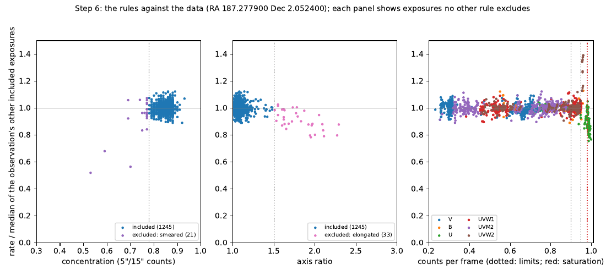
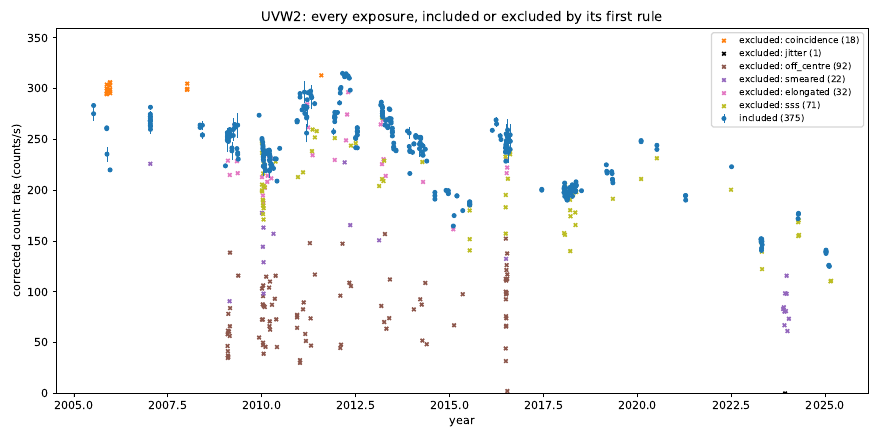

# Step 6 — Quality rules and the master table

`make_uvot_master_table.py` joins Steps 3–5 into one row per exposure: every
extension of every sky image, so each one is accounted for. Then it decides
by rule which exposures the light curve uses. Each row gets `include` = `yes`
or `no`, plus the rules that excluded it. The table is regenerated, never
edited. Your own decisions go in an overrides file, which is applied every
time, so a re-run never loses them.

It reads only the tables of Steps 3–5, so it runs in either terminal and
takes a few seconds.

## What runs

```bash
make_uvot_master_table.py
```

| Flag | Purpose |
| ---- | ------- |
| `--outdir` | Steps 3–5's output folder (default `UVOT_output`) |
| `--sss-level` | Exclude exposures on a low-sensitivity patch at this level or a stricter one: `LOW` (default), `MID` or `HIGH` |
| `--coincidence-limit FILTER=VALUE` | Change a filter's counts-per-frame limit (default 0.95; U only at the saturation cap, 0.98); can be repeated |
| `--psf-max-loss FRACTION` | Exclude (rule `psf`) exposures whose field stars show a larger loss of the 5″ circle, when the source's own shape cannot be measured (default: off, flag only) |

## How it works

**The rules.** An exposure is excluded if any of these applies. The limits
come from the 3C 273 data, as described below.

| Rule | Excludes | Why |
| ---- | -------- | --- |
| `step3:<status>` | exposures that were not candidates in Step 3 (`not_covered`, `partial`, ...) | no usable image of the source |
| `step4:<status>`, `step5:failed` | exposures without regions or photometry | nothing to use |
| `saturated` | more than 0.98 counts per frame | `uvotsource` caps the rate: it is only a lower limit |
| `coincidence` | above 0.95 counts per frame (U: not used, see `high_coi`) | the coincidence-loss correction goes wrong below the cap: UVW2 above 0.95 reads 13–39 % high |
| `sss` | on a low-sensitivity patch at `--sss-level` (LOW) | rates 5 % low on average, 29 % of them more than 10 % low |
| `off_centre` | source found more than 3″ from the region centre, so Step 4 left the region at `--ra`/`--dec` | the region misses the source: rates 0.30 of the truth |
| `smeared` | concentration (5″/15″ counts, Step 4) below 0.82; not applied to saturated exposures, whose flattened cores read 0.80–0.81 and whose rates are lower limits anyway | light outside the 5″ region: clean exposures are at 0.84 and above (95 %); the two below 0.82 read 5 % and 16 % low |
| `elongated` | axis ratio above 1.5 | trailed: 5–12 % low |
| `psf` | only with `--psf-max-loss`: the source's own shape is not measurable and the field stars show a larger loss | your choice of how much loss to accept |
| `jitter` | taken during the spacecraft jitter (7 August 2023 – 4 April 2024) without a PSF check (the source's own shape, or the field stars') or without a pointing it can trust (aspect correction, the source's centroid, or the field stars) | the image cannot be checked |
| `duplicate` | same `EXPID` as an included exposure (image- and event-mode copy) | counted once |
| `override:N` | excluded by line N of the overrides file | your decision |

Exposures with low S/N are *not* excluded: for a faint source they are the
non-detections Step 7 turns into upper limits. In the jitter period an
exposure whose PSF can be measured is judged by the shape rules like any
other.

**Faint sources: the field stars decide the PSF, as a flag.** When the
source's own concentration cannot be measured (Step 4 reports it only to
±0.02), the field stars' `psf_loss` (Step 4) says how much light a broad
PSF pushes out of the 5″ circle. By default this only flags: excluding at
a few per cent would throw away points like PKS 0537−286's 2022 flare
(V loses 7 %, against a 22 % error), and Step 7 can correct instead
(`--psf-correct`). `--psf-max-loss` turns the flag into a rule.

**Flags** mark included exposures without excluding them:

- `sss_mid` and `sss_high`: on a patch only at a level the rule doesn't exclude.
- `sss_edge`: the centre is clear, but more than 10 % of the 5″ circle lies
  on a LOW patch (Step 4's `sss_low_frac`).
- `jitter_ok`: taken during the jitter, but the PSF check passed.
- `high_coi`: U above 0.90 counts per frame. Kept, because for a bright
  source full-frame U is often the only U there is, but probably about 8 %
  low (full-frame U above 0.93 against windowed U of the same snapshot).
- `no_aspcorr`: no aspect correction. A bright source's region is centred
  on the source itself, a faint source's by the field stars (`recentred`).
- `psf_broad`: the source's own shape is not measurable, and the field stars
  show the 5″ circle losing at least 3 % (at ≥ 2σ) to a broad PSF.
- `psf_unchecked`: the source's own shape is not measurable and there are no
  field stars to tell (none in the exposure or its snapshot).
- `recentred`: Step 4 moved the regions by the field stars' pointing offset
  (over 1″). `pointing_unsure`: that offset is uncertain by more than 1.5″
  (borrowed from a snapshot whose filters disagree).
- `short`: exposure under 20 s.
- `discrepant`: the rate differs from the error-weighted mean of the rest of
  its observation and filter by more than 10 % and 5σ, both errors combined.
- `override:N`: included by line N despite the listed rules.

**Overrides.** Create `UVOT_output/uvot_overrides.txt`:

```
# obsid        filter  extname        action   note
00031659123    *       *              exclude  streaked second snapshot
00035017124    U       uu387398273I   include  checked by eye
```

`*` matches anything, and a later line wins over an earlier one. An
`include` can't bring back an exposure without photometry (e.g.
`not_covered`); the script warns and ignores it. When an override includes
an exposure the rules exclude, the `rules` column still lists those rules
and `flags` names the override line.

**Changes.** Each run compares `include` with the previous master table and
lists the exposures that changed, so a new rule, limit or override shows its
effect at once.

### How the limits were set

3C 273 does not change noticeably within one observation, so each exposure
can be compared with the clean exposures of the same observation and filter.
Clean means: not trailed or smeared, S/N ≥ 10, on no patch at any level,
not saturated, at most 0.95 counts per frame, and outside the jitter period.
Clean exposures agree with each other to ±2.8 % (16–84 %, leaving each one
out of its own reference).

**Coincidence loss: same-snapshot pairs.** Within a snapshot, each filter
often has a short exposure with 11 ms frames and a longer one with 3.6 ms
frames (a hardware window). The windowed exposure has far fewer counts per
frame, so the pair tests the correction of the full-frame one. Of 473
pairs, with full-frame rate ÷ windowed rate:

| Filter | Pairs | Full-frame / windowed |
| ------ | ----- | --------------------- |
| UVW1 | 102 | 1.00–1.01 up to 0.95 counts per frame |
| UVW2 | 16 | 0.99–1.00 up to 0.95 |
| UVM2 | 116 | 0.96–1.02 up to 0.85 (1.04 at 0.85–0.90, 3 pairs) |
| V | 141 | 0.98–1.03 (never above 0.8) |
| B | 10 | 0.89–1.02 at 0.85–0.97 (too few to judge) |
| U | 88 | 0.92 at 0.93–0.98 (median of 15; 16–84 %: 0.86–0.97); 0.85 saturated (72) |

Every full-frame U exposure of 3C 273 is above 0.9 counts per frame. Its
windowed partner is itself strongly corrected (0.76 counts per frame, a
factor of about 1.9), so which of the two is right can't be settled here.
An absolute check needs another method, such as readout-streak photometry
(a to-do). UVW2 at 0.955–0.96 counts per frame (13 exposures, all from 2005)
reads 13–39 % higher than the rest of its observation (right-hand panel of
the figure below).

**Shape.** The rate against concentration (axis ratio ≤ 1.5, region at the
centroid; references: concentration ≥ 0.84 and axis ratio ≤ 1.25) and
against axis ratio (concentration ≥ 0.78, measured with Step 4's earlier
median background):

| Concentration | Exposures | Rate / clean median | | Axis ratio | Rate / clean median |
| ------------- | --------- | ------------------- | - | ---------- | ------------------- |
| 0.88 and above | 262 | 1.00 | | up to 1.5 | 0.99–1.00 |
| 0.84–0.88 | 813 | 1.00 | | 1.5–1.7 | 0.95 |
| 0.82–0.84 | 30 | 0.99 | | above 1.7 | 0.88 |
| 0.78–0.82 | 2 | 0.84, 0.95 | | | |

Step 4 measures the concentration over the plain mean of the masked
annulus. Its earlier estimate, the annulus median, sat below the mean at a
few counts per pixel and spread short exposures' concentrations down to
0.75: the limit was 0.78 then, where those read 3 % low. With the mean,
clean exposures are tightly grouped (median 0.86–0.87 per filter, 1 % below
0.83), and the 88 exposures that read 0.76–0.82 before now read 0.82 or
more. The limit is 0.82.

**Low-sensitivity patches:** LOW 0.95, MID-only 0.99, HIGH-only 1.00 (Step
5). The default excludes LOW only; `--sss-level MID` also excludes the
MID-only exposures (about 1 % low).

**The jitter period** can't be checked this way: no jitter-period
observation of 3C 273 has two exposures in one filter that both pass the
shape checks. So its exposures are judged by their PSF.



*The first page of `uvot_master_table.pdf` for 3C 273. Each panel shows the
exposures no other rule excludes: rate against concentration, axis ratio
and counts per frame, relative to the observation's other included
exposures. Dotted lines mark the limits.*

For all of 3C 273:

```
[summary] 2935 exposures: 2102 included, 833 excluded
          filter  exposures  included  included exposure (s)
          V             487       455                  36445
          B             197       141                  11472
          U             505       276                  48374
          UVW1          528       417                  82048
          UVM2          571       440                 101959
          UVW2          647       373                 153932
[summary] exposures per rule (one exposure can break several):
          sss                        385, rate 0.94 of the included median (125 with one)
          smeared                    207, rate 0.40 of the included median (122 with one)
          saturated                  177, rate 0.86 of the included median (108 with one)
          elongated                  159, rate 0.41 of the included median (127 with one)
          off_centre                 103, rate 0.30 of the included median (81 with one)
          coincidence                 61, rate 1.27 of the included median (21 with one)
          step3:not_covered           41
          jitter                      15
          step3:partial                3
[summary] flags on included exposures: discrepant 1, high_coi 138, jitter_ok 15, no_aspcorr 752, psf_broad 2, psf_unchecked 24, short 437, sss_edge 150, sss_high 111, sss_mid 215
[check] included exposures that differ from the rest of their observation by more than 10 % and 5 sigma: 1
          00089029001 U     uu615761377I rate 338.45 +- 2.34
```

"Rate ... of the included median" compares each excluded exposure with the
included exposures of its observation and filter, where there are any. The
one `discrepant` U exposure (00089029001, 0.952 counts per frame) reads 14 %
below the rest of its observation: the steep end of the coincidence
correction.

## What to look for

- **U.** 276 of 505 U exposures are included; 138 of them are flagged
  `high_coi` (full-frame, 0.90–0.98 counts per frame, probably about 8 %
  low). They are all the U there is from 2017 to 2022. Step 7 keeps the
  flag on the combined points. To leave them out instead, use
  `--coincidence-limit U=0.90`.
- **UVW2.** Most of its exclusions are the trailed event-mode snapshot
  openers of 2009–2016 (`off_centre`, `elongated`, `smeared`).
- **Only saturated.** For 23 observation/filter pairs (all U) every measured
  exposure is saturated. Step 7 reports those as lower limits.
- **The jitter period.** 15 of 3C 273's 81 exposures from it are included.
  The others break one rule or more: smeared (54), elongated (17), no PSF
  check or trusted pointing (15: unaspected, with 3C 273 not found at its
  position and too few field stars in this sparse field), on a patch (10),
  off centre (9).
- **A faint source** (PKS 0537−286): its S/N is below 10 in every exposure,
  so Step 4 measures no shape or concentration, and the shape rules never
  apply; the field stars do the checking. 344 of its 368 exposures are
  included. Excluded: 15 on a LOW patch, 5 `step3:partial`, and the 4
  unaspected exposures of 00035240001 (`step4:not_covered`: the field stars
  put them 3.4′ off, with PKS 0537−286 outside the field). The 36
  jitter-period exposures are now included (field stars give both the PSF
  and the pointing), 35 of them, with the 2022 flare, flagged `psf_broad`
  (6–40 % lost; see Step 4).
- **`psf_broad` points** are biased low by their loss. Leave them, correct
  them in Step 7 (`--psf-correct`), or exclude them here
  (`--psf-max-loss 0.05`).
- **`discrepant` flags:** one for 3C 273 (above). Look at such exposures in
  the Step 4 viewer (`swift_uvot_viewer.py --obsid ...`) and exclude them
  with an override if the image is bad.

The per-filter pages of the PDF show every exposure's rate against time,
included or excluded by its first rule:



## Inputs and outputs

**Inputs:** `uvot_inventory.txt`, `uvot_positions.txt` and
`uvot_photometry.txt` from Steps 3–5; optionally `uvot_overrides.txt`.

**Outputs** (in `UVOT_output`):

```
UVOT_output/
├── uvot_master_table.txt   one row per exposure (columns below)
└── uvot_master_table.pdf   the rules against the data; the field stars' PSF loss and
                            pointing offset against time; rate against time per filter
```

| Column | What it is |
| ------ | ---------- |
| `obsid`, `filter`, `extname` | Which exposure |
| `date_mid`, `mjd_mid`, `exposure`, `frametime`, `mode`, `aspcorr`, `first` | From Step 3 (`first`: opens its snapshot) |
| `snr`, `offset`, `axis_ratio`, `conc`, `center`, `sss_low`, `sss_mid`, `sss_high` | From Step 4 |
| `counts_frame`, `saturated`, `rate`, `rate_err`, `rate_lim`, `mag`, `mag_err`, `mag_sys`, `flux_aa`, `flux_aa_err` | From Step 5 |
| `pnt_offset`, `n_stars`, `psf_loss`, `psf_loss_err` | From Step 4's field stars: pointing offset from Gaia (arcsec), PSF stars, light lost from the 5″ circle and its error |
| `include` | `yes` or `no` |
| `rules` | The rules that exclude the exposure, comma-separated (`-` if none) |
| `flags` | Notes that do not exclude it |

## Common variants

```bash
# Also exclude exposures on a MID-level patch
make_uvot_master_table.py --sss-level MID

# Exclude full-frame U above 0.90 counts per frame instead of flagging it
make_uvot_master_table.py --coincidence-limit U=0.90

# Exclude faint-source exposures whose field stars show more than 5 % loss
make_uvot_master_table.py --psf-max-loss 0.05

# The included exposures of one filter (include is column 33)
awk '$1 == "obsid" || ($2 == "UVW1" && $33 == "yes")' UVOT_output/uvot_master_table.txt | less -S
```

## Gotchas

1. **Don't edit the table.** It is rewritten on every run; put decisions in
   `uvot_overrides.txt`.

2. **Re-run after any earlier step.** The table is only as current as the
   Step 3–5 tables it reads.

3. **The limits were calibrated on one bright source.** For another bright
   target, check the first page of the PDF. It repeats the comparison with
   that target's own data.

4. **Two concentration limits.** Step 4 flags below 0.70 ("clearly trailed
   or smeared"); this step excludes below 0.82.

5. **Faint sources and the jitter period.** A faint source's jitter-period
   exposures are kept when the field stars measure both the PSF and the
   pointing, and flagged `psf_broad` when the PSF is broad (most of them).
   Without field stars (`--no-field-stars`, or none in the exposure) they
   are excluded.

## Notes

<!-- Eileen: drop observations here as you walk through. Format suggestion:
     - 2026-MM-DD — observation / gotcha / "I ran this on X and Y happened"
-->

_(no notes yet)_
