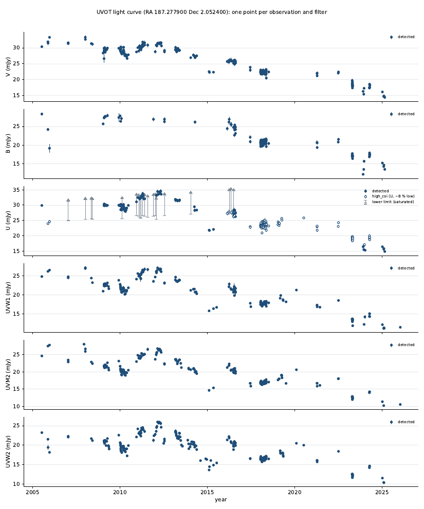
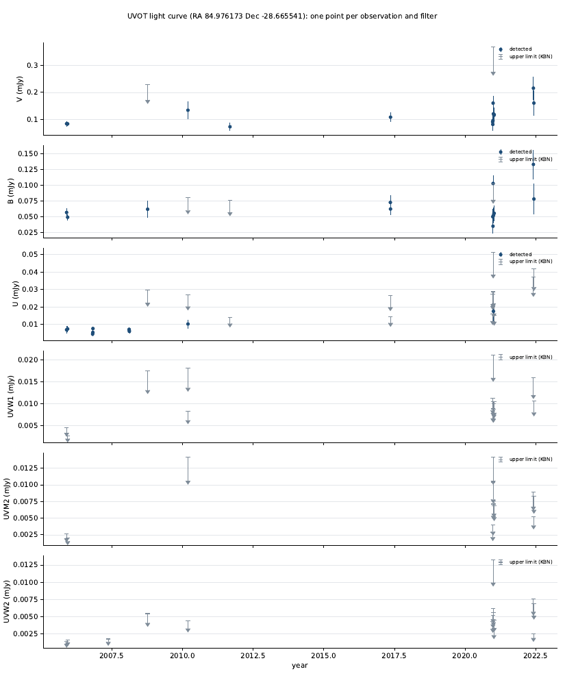

# Step 7 — The light curve

`swift_uvot_lightcurve.py` combines the included exposures of the
[Step 6](06-master-table.md) master table into one point per observation
and filter. It writes the light curve as a table, in count rates, Vega and
AB magnitudes and flux densities, and as a plot. It reads only tables, so it
runs in either terminal and takes a few seconds.

## What runs

```bash
swift_uvot_lightcurve.py
```

| Flag | Purpose |
| ---- | ------- |
| `--outdir` | Steps 3–6's output folder (default `UVOT_output`) |
| `--floor` | Systematic error per exposure, as a fraction of the combined rate (default 0.015) |
| `--nsigma` | Detection threshold in Gaussian σ; also sets the upper-limit confidence (3 → 99.87 %) and the sensitivity (default 3; 1–8) |
| `--bkg-sys` | Additive background systematic, as a fraction of the background in the aperture: one number for all filters, or e.g. `V=0.01,UVM2=0.05`; `0` switches it off (default: measured per filter, below) |

## How it works

**Combining.** The included exposures of one observation and filter are
averaged with weights. The obvious weight, 1/error², has a catch for faint
sources: each exposure's error comes from its own counts, so an exposure
that happened to catch fewer counts gets a smaller error and a larger
weight, and the mean comes out low (by about one count per exposure;
Mighell 1999). On blank sky that is −0.07 to −0.21σ per exposure, and up to
−1σ for many short UV exposures.

So the weights come from the counts each exposure is *expected* to have if
the source shines at the combined rate R:

- the expected counts in the 5″ circle are E = R·T/K + B, with T the
  exposure time, K the correction from raw to corrected rate (coincidence
  loss, sensitivity loss over time, large-scale sensitivity), and B the
  background expected there from the whole observation's background;
- `uvotsource`'s error is rescaled to these counts:
  σ² = e²·(E + V)/(max(N, 1) + V) + (f·R)², with e its error, N the
  counts it actually got, V the variance of the background subtracted and
  f the floor;
- R is iterated from the exposure-weighted mean (3C 273 converges in at
  most 4 steps). If it ever does not converge, the exposure-weighted mean
  is used and the reason says so.

For bright sources E ≈ N and the weights are `uvotsource`'s own; 3C 273's
points move by a median 0.000σ.

The floor f (1.5 %) is a fraction of the *combined* rate. Before PR2 it was
1.5 % of each exposure's own rate, which again favours exposures that read
low. It comes from the data: included exposures of one 3C 273 observation
scatter more than their statistical errors allow, and the fraction that
brings the reduced χ² to 1 is:

| V | B | U | UVW1 | UVM2 | UVW2 |
| - | - | - | ---- | ---- | ---- |
| 1.0 % | 1.6 % | 0.7 % | 1.1 % | 1.3 % | 1.4 % |

The U value leaves out the `high_coi` exposures. Mixed with windowed U they
raise it to 3.8 %, because they read about 8 % low. So within an observation
the `high_coi` U exposures are used only when there is no other U exposure.

**Background systematic.** The floor scales with the source, so it does
nothing for a faint one, whose error is dominated by the background. A
background that is wrong by a fraction ε adds ε × (background in the 5″
circle) to every exposure of an observation alike: it does not average
down, so it is added once to the combined point's error. ε was measured on
blank sky: 26 empty random positions in every included PKS 0537−286
exposure, combined like a source; ε is what makes the scatter of those
blank points match their errors:

| V | B | U | UVW1 | UVM2 | UVW2 |
| - | - | - | ---- | ---- | ---- |
| 0 | 1.8 % | 1.8 % | 0 | 0 | 2.6 % |

V, UVW1 and UVM2 need none. This was measured in one field; for a field
with a much brighter or more structured background, raise it with
`--bkg-sys`.

**Detection.** A point is `detected` if background alone would give the
summed counts of its exposures with a probability below that of a 3σ
Gaussian fluctuation (0.135 %). The probability is the Poisson one,
averaged over the uncertainty of the background (its statistical error
and the systematic above); `det_sigma` gives it as Gaussian σ. For bright
sources this is the same as rate/error ≥ 3. At low counts it is less
conservative, and correct: with 10 background counts, 22 counts are a
detection, where rate/error ≥ 3 needs 26. `snr` (rate/error) is still
listed, and can be slightly below 3 for a detected point.

**Upper limits.** For a point that is not detected, `rate_limit` is the
Kraft, Burrows & Nousek (1991) upper limit at 99.87 % (3σ), computed from
the summed counts and the background (with its uncertainty), divided by
the summed T/K. The old limit, max(rate, 0) + 3σ, falls below the true flux
0.4–2.2 % of the time instead of 0.135 % when the background in the
aperture is 30 counts or less (single UV exposures here have 2–130). KBN
keeps its 0.135 %. Near zero it is about 3.24σ above zero, and about 2σ
above it for a negative net rate. The measured `rate` and `rate_err` stay in
the table for every point.

**Sensitivity.** `rate_sens` and `mag_sens` are the rate a source would
need to be 3σ above the background alone: what many UVOT papers quote as
a "limit" (`uvotsource`'s `MAG_LIM` is similar). It depends only on the
background and exposure, not on what was measured, so it is listed for
every point. It is not an upper limit on the flux.

The point's time is the exposure-weighted mean of the exposures' midpoints.
`mjd_start` and `mjd_stop` span the exposures used. With two or more
exposures, `chi2_red` (from the same weights) shows how well they agree;
a point is flagged `scatter` if the χ² probability is below 0.001.

**Statuses.** Each observation and filter gets one:

| Status | Meaning |
| ------ | ------- |
| `detected` | `det_sigma` ≥ 3 |
| `upper_limit` | below that; the magnitude and flux columns hold `rate_limit` |
| `lower_limit` | nothing included, but some exposures were excluded only for saturation; the highest capped rate, a lower limit on the true one |
| `excluded` | exposures were measured, but none was included (the reason lists the rules) |
| `not_covered` | no exposure had the source in its field |

**Units.** Magnitudes and flux densities use `uvotsource`'s own conversion,
read from Step 5's output tables: the Vega and AB zero points and the flux
density per count/s in each filter. They are listed in the table header.
A filter in which no exposure has a positive rate (a faint source in the
UV) takes them from `uvotsource`'s limit columns instead, the same
conversion.
`mag_err` is statistical plus the floor and the background systematic. `mag_sys` is the absolute
calibration (zero-point) error: 0.01 mag in V, 0.02 in B and U, 0.03 in
the UV. It is not included in `mag_err`, because it shifts every point of
a filter together.

**Flags** carried from the exposures: `high_coi` (U, probably about 8 % low),
`jitter_ok` (taken during the 2023–24 jitter, PSF check passed),
`discrepant`, `sss_mid`, `sss_high`; and `scatter`.

For all of 3C 273:

```
[summary] filter  detected  upper_limit  lower_limit  excluded  not_covered  high_coi  scatter
          V            249            0            0        16            0         0        0
          B            125            0            0        25            0         0        0
          U            215            0           23        28            1        97        1
          UVW1         226            0            0        52            0         0        0
          UVM2         227            0            0        52            1         0        1
          UVW2         252            0            0        53            7         0        1
```



*`uvot_lightcurve.pdf` for 3C 273: flux density against time, one panel per
filter. Open circles are U points from `high_coi` exposures; grey arrows
pointing up are saturated lower limits (upper limits point down).*

For PKS 0537−286 (a faint blazar, V ≈ 19):

```
[summary] filter  detected  upper_limit  lower_limit  excluded  not_covered  high_coi  scatter
          V             14            2            0         4            0         0        0
          B             13            3            0         3            0         0        0
          U             10           14            0         3            0         0        0
          UVW1           0           14            0         3            0         0        0
          UVM2           0           13            0         5            0         0        0
          UVW2           0           15            0         3            0         0        0
```



*PKS 0537−286: detections in V, B and U; KBN upper limits (arrows down from
the limit) everywhere else.*

## What to look for

- **`high_coi` U points** (97 for 3C 273, all of U from 2017 to 2022): about
  8 % low. Compare them with UVW1 and B before using U colours.
- **Lower limits** (23, all U, 2007–2016): every exposure was saturated.
  They sit below the measured U points, as they should.
- **`jitter_ok` points** (13, Nov 2023 – Jan 2024): their PSF passed the
  shape checks, but look at them. (The V point of 00031659120, 2023-11-15,
  about 20 % below its neighbours, passed with the concentration limit of
  0.78 and is now excluded as `smeared` at 0.82.)
- **`excluded`** (226): for most of them (128) every exposure was on a LOW
  low-sensitivity patch. Excluding at LOW was the Step 6 default; Step 6's
  docs show the bias.
- **`scatter`** (3): the exposures of one observation disagree. The U point
  of 00089029001 contains the `discrepant` exposure from Step 6.
- **Non-detections:** none for 3C 273. For PKS 0537−286, every UV point
  is an upper limit, as expected for a red blazar at V ≈ 19.
- **What PR2 changed** (against the previous inverse-variance mean):
  3C 273's points moved by a median 0.000σ; the 11 that moved by more than
  0.1σ (at most 0.9σ, 0.45 %) all moved up and all have exposures that
  disagree (χ²_red 1.7–12.7), where the old per-exposure floor favoured the
  low ones. PKS 0537−286's points rose by up to 1.3σ (UV), as removing a
  downward bias should; three points changed status (two detections at
  S/N 3.2 and 4.9 became limits, one limit became a detection).

## Inputs and outputs

**Inputs:** Step 6's `uvot_master_table.txt`; Step 5's `uvot_photometry.txt`
and FITS tables (for the conversion factors).

**Outputs** (in `UVOT_output`):

```
UVOT_output/
├── uvot_lightcurve.txt    one row per observation and filter (columns below)
└── uvot_lightcurve.pdf    flux density against time, one panel per filter
```

| Column | What it is |
| ------ | ---------- |
| `obsid`, `filter` | Which observation and filter |
| `date_mid`, `mjd_mid`, `mjd_start`, `mjd_stop` | Exposure-weighted mean time (UTC) and the span of the exposures used |
| `status` | See above |
| `n_used`, `n_total`, `exposure` | Exposures used, exposures in the observation and filter, exposure time used (s) |
| `counts`, `bkg_counts` | Summed raw counts in the 5″ circles and the background expected in them |
| `det_sigma` | Poisson significance of `counts` over `bkg_counts`, as Gaussian σ (`>37` beyond double precision) |
| `rate`, `rate_err`, `snr`, `chi2_red` | Combined corrected rate (counts/s), its error (floor and background systematic included), rate/error, reduced χ² |
| `rate_limit` | Upper limit (KBN, 99.87 %) for points that are not detected |
| `rate_sens`, `mag_sens` | 3σ sensitivity: the rate (Vega magnitude) needed to be 3σ above the background alone |
| `mag`, `mag_err`, `ab_mag`, `ab_mag_err`, `mag_sys` | Vega and AB magnitudes; for an upper or lower limit the limit itself |
| `flux_aa`, `flux_aa_err`, `flux_mjy`, `flux_mjy_err` | Flux density (erg s⁻¹ cm⁻² Å⁻¹; mJy) |
| `flags`, `reason` | Flags carried from the exposures; why a point is a limit or excluded |

## Common variants

```bash
# A larger systematic floor
swift_uvot_lightcurve.py --floor 0.02

# A 5-sigma detection threshold and 99.99997 % limits
swift_uvot_lightcurve.py --nsigma 5

# A larger background systematic in the UV only
swift_uvot_lightcurve.py --bkg-sys UVW1=0.03,UVM2=0.03,UVW2=0.04

# The detected UVW1 points
awk '$2 == "UVW1" && $7 == "detected"' UVOT_output/uvot_lightcurve.txt | less -S
```

## Gotchas

1. **Re-run after Step 6** (a new rule, limit or override).

2. **Fluxes are not dereddened.** Galactic extinction correction is a
   separate, planned script.

3. **The conversion assumes `uvotsource`'s spectrum.** Its flux factors are
   for an average spectrum; for strong emission lines or very red sources
   the flux density in a broad UV filter can be off. Count rates are the
   safe quantity.

4. **`mag_sys` is not in `mag_err`.** Add it when comparing with other
   instruments, not when comparing UVOT points of one filter.

5. **An upper limit is not the sensitivity.** Quote `rate_limit` (or
   `mag`) for a non-detection; `mag_sens` says how faint a source could
   have been detected, whatever was measured. Papers mix the two.

6. **Unaspected exposures can miss a faint source** (flag `no_aspcorr` in
   Step 6): without aspect correction the pointing can be off by more than
   5″. A bright source is re-centred in Step 4, a faint one cannot be. In
   PKS 0537−286's 00035240001 every field star reads about zero in its four
   unaspected exposures. A field-star check is planned.

## Notes

<!-- Eileen: drop observations here as you walk through. Format suggestion:
     - 2026-MM-DD — observation / gotcha / "I ran this on X and Y happened"
-->

_(no notes yet)_
